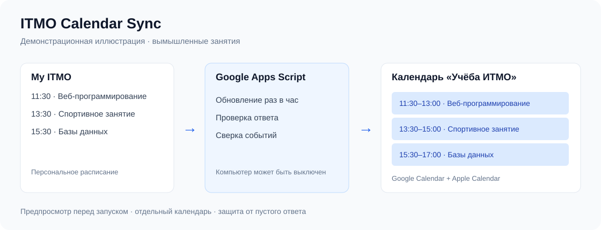

# 📅 ITMO Calendar Sync

**Стек:** JavaScript · Google Apps Script · Google Calendar



*Иллюстрация с вымышленными занятиями: показывает путь данных и результат синхронизации.*

**Расписание My ITMO в Google Календаре и на iPhone — с обновлением каждый час.**

[Установка](docs/setup.md) · [Настройка и команды](docs/customization.md) · [Ошибки](docs/troubleshooting.md)

```text
My ITMO → ваш Google Apps Script → Google Календарь → Apple Calendar
```

Персональный скрипт работает в облаке Google: сервер и постоянно включённый компьютер не нужны. Каждый пользователь создаёт собственный проект и вводит свои данные в его закрытых настройках.

## Возможности

- Перенос занятий на ближайшие 28 дней в отдельный календарь «Учёба ИТМО».
- Предпросмотр перед первым запуском.
- Обновление времени, аудитории и описания без дубликатов при неизменном расписании.
- Спортивные занятия, если они присутствуют в персональном ответе My ITMO.
- Отложенная отметка отмен: две успешные проверки с интервалом минимум 30 минут.
- Защита от пустого, некорректного или резко сократившегося расписания.
- Московский часовой пояс и синхронизация с Apple Calendar через Google-аккаунт.

## Быстрый старт

1. Создайте личный проект на [script.google.com](https://script.google.com/).
2. Вставьте содержимое [src/itmo-calendar.gs](src/itmo-calendar.gs) в редактор.
3. В свойствах скрипта задайте `ITMO_USERNAME` и `ITMO_PASSWORD`.
4. Выполните `previewItmo` и сверьте занятия с My ITMO.
5. В течение часа выполните `startItmoSync`.

Подробности, права доступа и подключение iPhone: **[пошаговая инструкция](docs/setup.md)**.

## Приватность и ограничения

Пароль хранится в свойствах вашего проекта Google Apps Script, а не в этом репозитории. Редакторы проекта могут его прочитать — не предоставляйте посторонним доступ и не публикуйте проект как веб-приложение. Google обрабатывает выполнение скрипта; доступ к календарям выдаётся вашему проекту.

Неофициальный проект, не связан с ИТМО или Google. Используется внутренний API My ITMO: изменения входа, дополнительная проверка или изменение формата могут остановить обновление. Пустой ответ, например во время каникул, считается ошибкой и сохраняет календарь. Массовые отмены требуют ручной проверки.

Перенос занятия создаёт новую запись и позднее помечает прежнюю отменённой. Возвращённое занятие восстанавливается, но удалённые при отмене уведомления автоматически не возвращаются. Изменения записей не являются транзакцией: при ошибке Google возможна частичная запись; следующий запуск повторно сверит данные.

## Структура

```text
src/      скрипт для Google Apps Script
docs/     установка, настройка и устранение ошибок
tests/    проверки на искусственных данных без входа в аккаунты
.github/  автоматическая проверка при изменениях
```

## Проверки

Нужен Node.js 22 или новее, дополнительные пакеты не требуются:

```sh
node tests/sync.test.cjs
```

Проверяются повторный запуск, изменение аудитории, перенос, отмена и восстановление, ошибки источника и ограничение адреса отправки пароля. Реальная ручная синхронизация проверена 13 октября 2026; выполнение часового триггера на тот момент отдельно не наблюдалось. Локальные тесты не проверяют актуальную доступность API и Google.

## Участие

Предложения и исправления приветствуются через Issues и Pull Requests. Для ошибки приложите обезличенное описание и ожидаемый результат. Не прикладывайте пароль, токены, cookies, номер ИСУ или персональное расписание.

## Благодарности

Способ получения расписания основан на исследовании проекта [iburakov/my-itmo-ru-to-ical](https://github.com/iburakov/my-itmo-ru-to-ical). Здесь используется собственная реализация на Google Apps Script с записью в Google Календарь.

## Лицензия

[MIT](LICENSE) — можно использовать, изменять и распространять с сохранением уведомления о лицензии.

## Общий доступ к расписанию и подключение на iPhone

Для просмотра чужого расписания не нужно устанавливать скрипт или передавать пароль. Владелец открывает доступ к календарю в Google, а получатель подключает **свой Google-аккаунт** к приложению Apple «Календарь».

### Если вы добавляете человека к своему календарю

1. На компьютере откройте [Google Календарь](https://calendar.google.com) под аккаунтом владельца.
2. Слева в разделе **«Мои календари»** найдите нужный календарь.
3. Нажмите **⋮ → «Настройки и общий доступ»**.
4. Найдите раздел **«Доступ для отдельных пользователей или групп»** / **«Общий доступ»** и нажмите **«Добавить пользователей»** / **«Добавить пользователей и группы»**.
5. Введите адрес Google-аккаунта получателя — именно того, которым он будет пользоваться на iPhone.
6. Выберите права и нажмите **«Отправить»**:

   | Права | Для чего подходят |
   | --- | --- |
   | Только информация о свободном и занятом времени | Показывать занятые промежутки без названий и подробностей |
   | Просмотр всех сведений о мероприятиях | Показывать расписание, названия и аудитории; приватные события могут скрывать детали |
   | Изменение мероприятий | Совместно редактировать события; для простого просмотра не требуется |

7. Попросите получателя принять приглашение и выполнить шаги ниже.

**Каждый календарь подключается отдельно.** Например, пары и физра находятся в «Учёба ИТМО», а рабочие блоки и личные дела могут находиться в другом календаре. Чтобы показать оба, выдайте доступ к каждому.

Доступ распространяется на календарь целиком, включая новые события. Проверьте личные записи перед приглашением. Делать календарь общедоступным в интернете не требуется.

Чтобы прекратить доступ, удалите человека из списка в настройках общего доступа.

### Если вас добавляют к чужому календарю

#### 1. Примите приглашение

1. Откройте письмо с приглашением и перейдите по ссылке добавления календаря.
2. Войдите в **тот Google-аккаунт, на адрес которого пришло приглашение**, и подтвердите добавление, если появится запрос.
3. Проверьте в [веб-версии Google Календаря](https://calendar.google.com), что календарь появился в списке, обычно в разделе **«Другие календари»**, и включено его отображение.

Если ссылка из письма не работает на телефоне, выполните этот шаг на компьютере. Сначала календарь должен появиться в Google, затем подключайте его на iPhone.

#### 2. Подключите свой аккаунт к iPhone

1. Откройте **«Настройки» → «Приложения» → «Календарь» → «Учётные записи календаря»**.
2. Нажмите **«Добавить учётную запись» → Google**.
3. Войдите в свой аккаунт, которому предоставили доступ.
4. Включите **«Календари»** и сохраните настройки, если появится кнопка сохранения.

Если аккаунт уже добавлен, откройте его настройки и проверьте переключатель **«Календари»**. На старых версиях iOS путь может начинаться с **«Настройки» → «Календарь» → «Учётные записи»**. Почту и контакты включать необязательно.

#### 3. Включите отображение чужого календаря

1. Откройте стандартное приложение Apple **«Календарь»**.
2. Нажмите **«Календари»** внизу экрана.
3. В разделе своего Google-аккаунта отметьте календарь, которым с вами поделились.
4. Нажмите **«Готово»** и проверьте дату с известным событием.

**Кнопка «Добавить календарь» здесь не нужна:** общий календарь должен появиться в списке после принятия приглашения и синхронизации аккаунта.

#### Если календарь не появился

1. Убедитесь, что он уже виден в веб-версии Google Календаря и открыт под правильным аккаунтом.
2. В Safari откройте [выбор синхронизируемых календарей](https://calendar.google.com/calendar/syncselect).
3. Выберите аккаунт получателя, отметьте нужный календарь и нажмите **Save / «Сохранить»**.
4. Вернитесь в приложение Apple, откройте **«Календари»**, потяните список вниз для обновления и подождите синхронизации.

Если видны только занятые часы, попросите владельца предоставить **«Просмотр всех сведений о мероприятиях»**. Если появляется ошибка подключения, проверьте Google в Safari и попробуйте другую сеть.

### Что важно помнить

- Изменения синхронизируются автоматически, с возможной задержкой. Повторно импортировать события не нужно.
- Установка собственной синхронизации My ITMO и просмотр чужого расписания — разные действия: для просмотра достаточно общего доступа.
- **Не выдавайте доступ к проекту Apps Script ради просмотра календаря:** редакторы проекта могут прочитать сохранённый пароль ИТМО.
- События календаря «Учёба ИТМО» лучше изменять через источник: ручные изменения могут быть перезаписаны следующим обновлением.

Официальная справка: [общий доступ Google](https://support.google.com/calendar/answer/37082?hl=ru), [добавление чужого календаря](https://support.google.com/calendar/answer/37100?hl=ru), [подключение Google к календарю Apple](https://support.google.com/calendar/answer/99358?co=GENIE.Platform%3DiOS&hl=ru).
